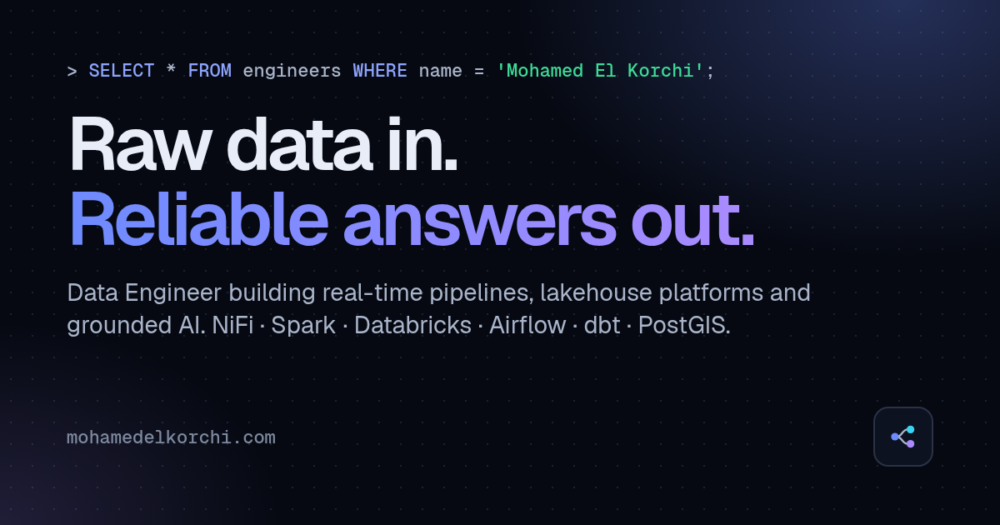

# mohamedelkorchi.com

Personal portfolio of **Mohamed El Korchi, AI & Data Engineer**: the data and AI systems behind Freshtrack, case studies and resume.

**Live:** https://mohamedelkorchi.com · [](https://github.com/Med-Dev-99/Portfolio/actions/workflows/ci.yml)



## Stack

| Layer | Choice | Why |
| --- | --- | --- |
| Framework | [Astro 7](https://astro.build) (static output) | Plain HTML at build time; zero framework JavaScript sent to the browser |
| Styling | [Tailwind CSS v4](https://tailwindcss.com) | CSS-first theme tokens, light/dark via CSS variables, only used classes ship |
| Fonts | Geist + Geist Mono (self-hosted, variable) | No third-party requests; latin subsets preloaded |
| Motion | SVG pipeline simulation (≈4 KB), CSS scroll-driven animations, View Transitions, Popover API | Native browser features instead of JS libraries; pauses off-screen, honours reduced motion |
| Navigation | Speculation Rules (HTTP header) | Internal pages prerender on hover for instant loads |
| Serving | ~20 MB Docker image (Alpine + Nginx, non-root), behind an Nginx TLS proxy and Cloudflare | Read-only container, pre-compressed assets, strict CSP (allows only Cloudflare Web Analytics) |
| CI/CD | GitHub Actions: build, secret scan, smoke test, CVE scan, GHCR, blue/green deploy | Every push to `main` is tested and live in minutes, with zero downtime and one-click rollback |

Scripts, all small and framework-free:

- `public/theme.js` (≈1 KB): applies the saved theme before first paint.
- `HeroStream.astro`: the hero canvas, where raw records pass a validation gate and assemble the name.
- `ArchMap.astro` (≈2 KB of script): each project drawn as a layered architecture diagram (sources → ingest → process → store → serve). Pick a flow to light up its data path, hover a component to see what it does and every flow that uses it; while on screen it steps through the flows by itself. Phones get the selected flow as a vertical pipeline; without JavaScript the full diagram and every caption are shown.
- `Header.astro` (<1 KB): section links show pipeline-run states (pending → running → done) as you scroll.

## Develop

Requires Node.js 22.23+ (see `.nvmrc`).

```bash
npm install
npm run dev          # http://localhost:4321
npm run build        # type-check + static build into dist/
npm run preview
```

## Edit the content

Everything shown on the site lives in **[`src/data/profile.ts`](src/data/profile.ts)**: hero text, headline numbers, projects, experience, skills, education and credentials. Change it and rebuild.

The case studies are in [`src/pages/work/`](src/pages/work/).

## Resume and social images

```bash
npm run resume
```

This renders, with headless Chrome:

- `public/resume/Mohamed-El-Korchi-Resume.pdf` from `src/data/profile.ts` + [`src/data/resume.ts`](src/data/resume.ts)
- `public/og*.png` (link previews) and `public/apple-touch-icon.png`

`resume.ts` holds resume-only details such as the phone number; the website never imports it. Set `CHROME_PATH` if Chrome isn't found.

## Images

Screenshots in `public/images/` are pre-optimised WebP files in two widths, named `name-<width>.webp`, and rendered by [`Shot.astro`](src/components/Shot.astro) with `srcset`. To add one:

```bash
magick input.png -resize '1440x>' -strip -quality 82 public/images/<project>/<name>-1440.webp
magick input.png -resize '800x>'  -strip -quality 82 public/images/<project>/<name>-800.webp
```

## Docker

```bash
npm run docker:preview     # build the production image and serve it on http://localhost:8080
```

The [`Dockerfile`](Dockerfile) builds the site with Node, then copies only the static files and the Nginx config into Alpine + Nginx, which runs as a non-root user. Base images are pinned by digest and kept current by Dependabot.

## Deploy

Push to `main`. [GitHub Actions](.github/workflows/ci.yml) runs these steps:
1. type-checks and builds the site;
2. scans the git history for secrets;
3. builds the image once, smoke-tests it with production hardening and scans it for CVEs;
4. publishes it to GHCR;
5. deploys it blue/green to the VPS through a restricted SSH gateway;
6. checks that the live site serves the new commit.

```bash
npm run deploy             # break-glass deploy from this machine (same image, tests and gateway)
```

[deploy/README.md](deploy/README.md) covers the server layout, first-time setup (secrets and variables), rollback and logs.

## License

Code is MIT. Written content, screenshots and the resume are © Mohamed El Korchi.
